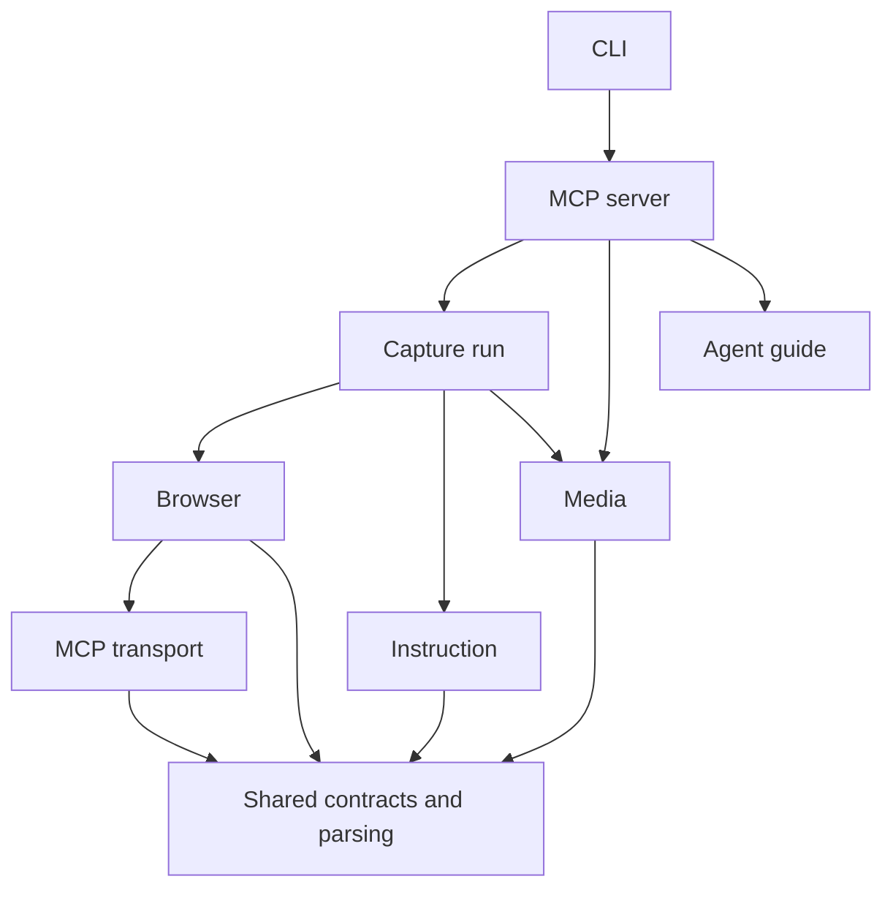

# Architecture

Screencaster uses capability modules with a small orchestration layer. This follows
the feature-oriented organization documented by Diplodoc CLI while keeping the
standalone package boundary used by Diplodoc utils. Modules separate transport,
application orchestration, browser execution, and media processing.

The diagram describes runtime dependencies. Capability modules may import shared
contract types without introducing runtime coupling. TypeScript type-only imports
are erased. `test/architecture/dependencies.test.ts` checks module boundaries,
source filenames, local import resolution, and runtime import cycles.

## Public API and layout

`src/index.ts` composes the library API. `src/cli.ts` starts the MCP server.
`package.json` maps public subpaths to their implementations. Legacy camel-case
and class-name import aliases remain available, alongside canonical kebab-case
aliases. Internal directories are not opened with wildcard exports.

Tests live in `test/unit/`, `test/browser/`, and `test/architecture/`. The production
compiler includes `src/`; the test compiler checks both trees with a common root.
SonarCloud also points to `test/`. Installed-package validation builds a tarball,
installs it outside the checkout, and checks exports, declarations, CLI startup,
and packaged agent instructions.

## Execution realms

Browser code runs in three separate environments:

1. The package process owns policy, transport, artifact registration, and files.
2. The MCP driver VM receives the Playwright page and a JSON data argument.
3. A page or element evaluation runs inside the DOM realm.

Typed programs live in `src/browser/scripts/driver/` and `dom/`. esbuild bundles
imports into self-contained IIFEs. A `?script` import produces a self-contained callable DOM
function. Playwright receives the function value; the driver serializes it. The wrapper uses ordinary parameters so strict-mode output is valid,
and preserves `this` for CDP hit-testing. Data crosses realms through explicit
arguments. This avoids dependencies on a host closure, function names preserved by
a particular compiler, or handwritten JavaScript fragments.

`driverScript()` and `domScript()` cache bundled source. The trusted host observer
extension remains a separate source-code boundary; it is never a model-facing
browser tool. Development, tests, watch, and package builds all produce the same
bundled programs.

## Configuration

Each capability keeps defaults and bounds in `config.ts`, regular expressions in
`patterns.ts`, and diagnostic text in `messages.ts`. Browser-script configuration
has its own files so the bundles can include it without Node dependencies.

Important settings include MCP timeouts, interaction sampling intervals, geometry
precision, private file modes, frame and activity limits, audio sample rates,
FFmpeg timeout and encoders, and preview limits. `FFMPEG_PATH` selects an executable;
provider and browser policies remain explicit caller options. Protocol names and
schema discriminants define the supported contracts.

## Runtime state and action ownership

`BrowserRuntime` composes three state collaborators:

- `RuntimeState` owns `idle → starting → ready → stopping → stopped`, startup and
  shutdown failure, and `aborting → aborted`. Cancellation and detected context
  replacement prevent restarting the owned session. Shutdown joins in-flight
  startup; repeated close/abort calls reuse the same work.
- `DialogState` owns unverified/verified pages, dispatch ownership, returned
  actions and native dialogs. Only a returned action can retain its initiating
  page. A dialog observed on a different URL/tab permits cancellation only.
  A failed dispatch clears ownership; the narrowly checked deferred-navigation
  path may recover it from a native beforeunload observation on the exact source.
- `DispatchState` owns a monotonic dispatch counter and classifies pre-dispatch
  refusal, failed passive observation and an unknown mutation outcome.

The coordinator still owns policy, context continuity checks and dispatch. It
rejects overlapping model-facing calls before dispatch and never retries a
mutation. `BrowserSession` keeps its single-start facade and exposes `phase` for
inspection. `BrowserContextGuard` reports detected replacement to runtime state;
temporary probe failure remains distinct from proof of context loss.

## Capture and illustration boundaries

`ScreenshotCapturePolicy` is host-owned configuration. The browser waits for
bounded ready/not-ready conditions, applies declared DOM redaction/hiding and
checks configured visible values and supported surfaces before/after pixels.
Known source values are registered for model-text masking before initial
observation. Native screenshot forwarding cannot bypass a configured policy.
The runtime refuses DOM-redacted screenshot capture combined with raw video;
a separately sanitized fixture is required for video.

A clean original means the unannotated **post-redaction** PNG. Highlighting uses
the generic local raster renderer in `shared/image-renderer.ts`, retains that
original and registers a derived PNG linked by source path/SHA-256. It does not
open a second browser context. Model attachment resizing is local too and never
rewrites production artifacts.

`media/illustration/` is an offline capability: analyze local PNG/JPEG, inspect a
contact sheet, confirm the analysis hash, then produce crop/outline/dim panels,
collages, QA data and optional YFM. Coordinates are physical input pixels; DPR
and viewport retain their own units. Production panels keep their resolution.
Source and preview hashes are checked again at production time. Output folders
are exclusive and prior exports stay immutable.

Machine, visual and publication statuses are independent. Production leaves
visual review pending and publication draft. Trusted host review appends a new
attestation tied to exact source/production/artifact hashes. Verification takes
an explicitly selected review; there is no automatic model PASS or publication.
Hash binding does not authenticate the reviewer or prove that visual work happened.

The application/MCP bridge accepts only unchanged registered source artifacts and
saved analyses from the owned run, uses measured screenshot geometry and returns
a preview attachment. Host authentication, service-specific policy factories and
redaction dictionaries stay outside model-facing tool arguments. An authentication
challenge returns bounded manual-continuation metadata before capture starts.
Typed host examples contain portable contracts. Organization-specific adapters
stay outside public code and package artifacts.

See [illustrations.md](illustrations.md), [host-adapters.md](host-adapters.md) and
the nearest `MODULE.md` for operational contracts and conservative privacy limits.

## Large recording metadata

`scanFrames()` validates FFmpeg framemd5 output as a stream. Callbacks verify
selected frames immediately; final-video checks retain only metadata and counts.
Raw-source hashes live in `FrameTable`: chunked 16-byte hashes and 4-byte indices.
Export selection uses byte masks, frame references use `Uint32Array`, and rendering
derives selection/hold filters from the monotonic range map without a second
per-frame Set. Narration uses packed occurrence counts and hold references.

The public `readFrames()`, `expandFrameMap()` and `fitAudio()` eager array contracts
remain available. Internal export paths use packed variants. Every retained clean
frame, including each held repeat, is still compared to the original source hash
and expected position before decoration. Final count/rate/audio and unchanged raw
SHA-256 checks remain mandatory. Limits are checked before expanded allocations.

## Journal durability

Run manifests, media journals and JSONL events share one `JournalWriter` per run.
Enqueue captures serialized immutable values; writes run asynchronously in order.
Adjacent unstarted snapshots of the same file can be coalesced. Events are never
coalesced. Snapshots use private exclusive temporary files, fsync, atomic rename
and parent-directory fsync; appends sync the file and directory as well.

`CaptureRun` drains earlier writes before an operation and its receipts before
returning success or failure. A persistence failure remains sticky, prevents new
actions and preserves unknown-outcome classification and action IDs. Finalization
and cancellation still stop the browser even when persistence has failed, and
attempt to drain all remaining writes. Media finalization drains before artifact
hashing and registration.

The synchronous `registerPlan()`, `beginStep()`, `completeStep()`, `proposeEdit()`
and `MediaRecorder.save()/clock()/record()` APIs enqueue persistence. Direct callers
must `await run.flush()` / `await recorder.flush()` before reading files or exiting.
All async run operations and MCP handlers provide that barrier automatically.
An unawaited enqueue is not a durable receipt; process termination before a barrier
can lose pending data. A sticky I/O error requires inspecting retained material,
not replaying a possible browser mutation.

`npm run benchmark` builds and type-checks the isolated metadata/journal benchmark.
See [architecture-review.md](architecture-review.md) for measured scope and limits.

## Agent instructions

The repository's root `AGENTS.md` provides development context and points to the
Screencaster skill. `.agents/skills/screencaster/SKILL.md` is the discoverable skill
entry point; conditional workflow details live in `references/`. `readHarness()`
and the MCP help tool read that same content from both source and installed builds.

Repository skill discovery depends on the agent supporting `.agents/skills/`.
Installing an npm package does not register its skill with an arbitrary agent.
Consumers can copy or link the packaged skill directory into the skill location
supported by their agent. The package does not change global agent configuration.
